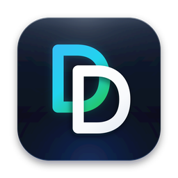
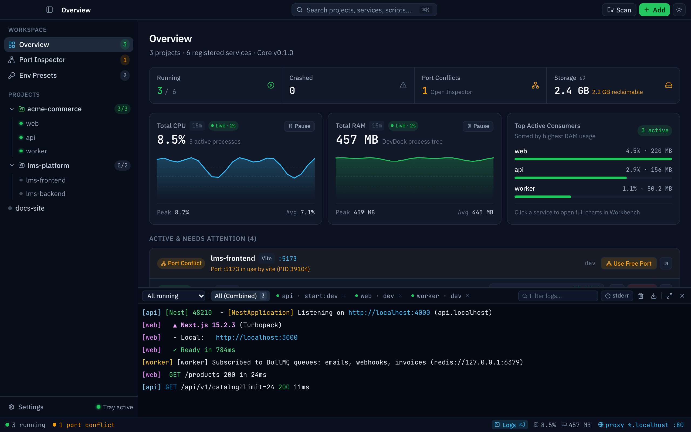
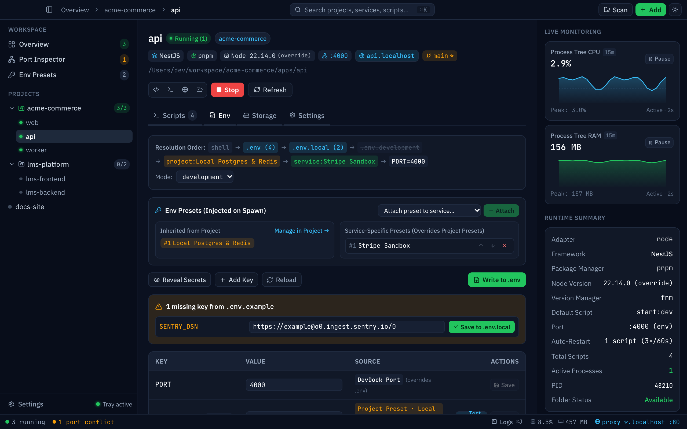
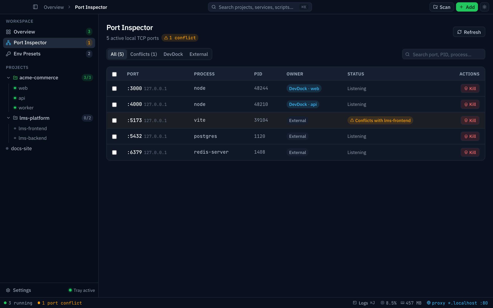

<div align="center">
  
  <h1>DevDock</h1>
  <p>
    A lightweight desktop workspace manager for local Node.js services, monorepos, and multi-folder projects.<br />
    Built with Tauri v2, Rust, and React.
  </p>
  <p>
    <a href="https://github.com/ramafikri02/devdock/releases">
      
    </a>
    
    <a href="LICENSE">
      
    </a>
  </p>
</div>

<br />

<p align="center">
  <picture>
    <source media="(prefers-color-scheme: dark)" srcset="docs/assets/preview-dark.png" />
    <source media="(prefers-color-scheme: light)" srcset="docs/assets/preview-light.png" />
    
  </picture>
</p>

## What it does

DevDock keeps local Node.js services, environment variables, ports, and logs in one desktop window instead of scattered terminal tabs.

- **Projects & Services** — Register single repositories, monorepos (`workspaces` / `pnpm-workspace.yaml`), or group separate folders (such as a frontend and backend repo) into one Project Hub with ordered start/stop orchestration.
- **Process Tree & Log Drawer** — Run `package.json` scripts using the detected package manager (`npm`, `pnpm`, `yarn`, `bun`) and `fnm` Node versions. Stops terminate the full process tree (`SIGTERM → SIGKILL` on Unix, Job Objects on Windows), with opt-in auto-restart (`3× / 60s`) and a persistent ANSI log drawer (`⌘J`).
- **Layered Env & Keychain Presets** — Inspect `.env*` precedence alongside `.env.example` validation, test local database connections (PostgreSQL, MySQL/MariaDB, MongoDB, Redis), and store secret preset values in macOS Keychain or Windows Credential Manager.
- **Ports & `*.localhost` Proxy** — Assign persistent ports per service, catch conflicts before launch, inspect or kill active local TCP listeners, and route running services through a built-in HTTP/WebSocket reverse proxy (`service.localhost`).
- **Monitoring & Desktop Tools** — Live 2-second process-tree CPU/RAM sparklines, `node_modules` and build-cache cleanup, system tray controls, quick-open actions (editor, terminal, browser, Finder/Explorer), Git branch/dirty indicators, Command Palette (`⌘K`), and passphrase-encrypted export/import across macOS and Windows.

<table>
  <tr>
    <td width="50%">
      
      <p align="center"><sub>Service Workbench — layered <code>.env</code> resolution, presets, and live CPU/RAM metrics</sub></p>
    </td>
    <td width="50%">
      
      <p align="center"><sub>Port Inspector — active local TCP ports with conflict detection</sub></p>
    </td>
  </tr>
</table>

## Installation

Download the latest build for **macOS Apple Silicon (`.dmg`)** or **Windows (`.msi` / `.exe`)** from [GitHub Releases](https://github.com/ramafikri02/devdock/releases).

> [!NOTE]
> **macOS unsigned builds:** Pre-built open-source macOS binaries are not notarized with an Apple Developer certificate yet. If macOS reports *"DevDock is damaged and can't be opened"* or blocks launch via Gatekeeper:
> 1. Move `DevDock.app` to `/Applications`.
> 2. Clear the quarantine attribute:
>    ```bash
>    xattr -cr /Applications/DevDock.app
>    ```
>    Alternatively, open **System Settings → Privacy & Security** and click **Open Anyway**.

## Local Development

Prerequisites: Rust stable (`cargo`), Node.js 20+, and `pnpm`.

```bash
pnpm install
pnpm typecheck
pnpm build
cargo test --workspace
pnpm tauri dev
```

Run the end-to-end smoke test (builds and launches the desktop binary against a temporary Node.js fixture):

```bash
pnpm test:e2e
```

<details>
<summary>Publishing signed releases &amp; auto-updates from a fork</summary>

DevDock uses Tauri's updater (`latest.json` on GitHub Releases).

1. Generate a signing keypair:
   ```bash
   pnpm tauri signer generate -w ~/.tauri/devdock.key
   ```
2. Copy the contents of `~/.tauri/devdock.key.pub` into `plugins.updater.pubkey` in `src-tauri/tauri.conf.json`.
3. Add `TAURI_SIGNING_PRIVATE_KEY` (and optional `TAURI_SIGNING_PRIVATE_KEY_PASSWORD`) to your repository's GitHub Actions Secrets.
4. Push a `v*` tag (e.g. `git tag v0.1.0 && git push origin v0.1.0`) to trigger `.github/workflows/release.yml`.

</details>

## Contributing

See [CONTRIBUTING.md](CONTRIBUTING.md) for the architecture overview and guides on adding new `ProjectAdapter` ecosystems or `VersionManager` adapters.

## License

[MIT](LICENSE)
